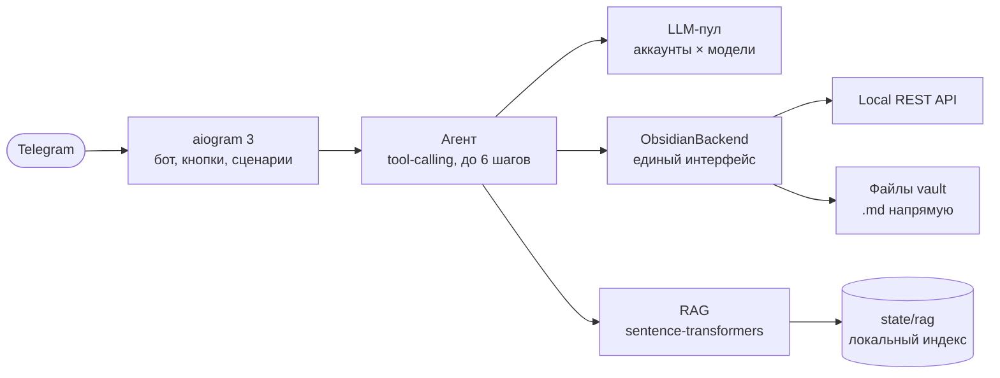

<h1 align="center">TG-OBS</h1>

<p align="center">
  <b>Telegram-бот с AI-агентом для Obsidian</b><br/>
  Скажите обычными словами, что нужно сохранить или найти — бот сам разберётся<br/>
  с заметкой, разделом, папкой и связями. Obsidian при этом может быть закрыт.
</p>

<p align="center">
  <a href="https://www.python.org/"></a>
  <a href="https://aiogram.dev/"></a>
  <a href="https://obsidian.md/"></a>
  <a href="LICENSE"></a>
</p>

<p align="center">
  <a href="#быстрый-старт">Быстрый старт</a> ·
  <a href="docs/INSTALL.md">Установка для новичков</a> ·
  <a href="docs/PROMPTS.md">Свои промпты</a> ·
  <a href="docs/README.md">Документация</a>
</p>

---

## Что это

**TG-OBS** — личный ассистент для Obsidian, который живёт в Telegram. Вы пишете
«запиши мысль…», «допиши в заметку про…», «что я писал про сроки релиза?» — бот
находит нужную заметку, выбирает раздел, оформляет текст по вашему шаблону,
предлагает связи и показывает превью перед записью.

Это не бот с жёстким набором команд. Модель получает список инструментов
(`search_notes`, `create_note`, `append_note`, `edit_section`, `add_links` и
другие) и вызывает их по смыслу. Поэтому формулировка может быть любой, а
неоднозначные места бот уточняет, а не додумывает.

Работает в двух режимах:

- **vault** — бот читает и пишет `.md`-файлы напрямую. Obsidian может быть
  закрыт, плагины и API-ключ не нужны.
- **rest** — через плагин Obsidian Local REST API. Obsidian должен быть
  запущен, зато доступны его поиск, алиасы и теги.

Режим выбирается одной переменной. По умолчанию (`auto`) включается `vault`,
если задан путь к хранилищу, иначе `rest`.

## Возможности

| | Возможность | Что делает |
|---|---|---|
| 🗣️ | **Понимает речь** | «сохрани это», «поправь там», «что я писал про…» — контекст диалога учитывается |
| 📝 | **Создаёт заметки** | по шаблону или без, в вашем стиле, с frontmatter и подставленной датой |
| ✏️ | **Дополняет и правит** | дописывает в нужный раздел, заменяет раздел целиком, удаляет строку, ссылку или абзац |
| 🗂️ | **Управляет структурой** | создаёт разделы и папки, переименовывает, переносит, копирует и удаляет заметки |
| 🔗 | **Ставит связи** | подбирает `[[ссылки]]` на существующие заметки и проставляет их во всём хранилище одной операцией |
| 🧠 | **Ищет по смыслу** | локальные эмбеддинги находят заметку, даже если точных слов в ней нет. Без облака |
| 🔁 | **Переживает лимиты** | пул аккаунтов и моделей: `429` → следующий аккаунт, потом следующая модель, затем автосброс |
| 🔌 | **Работает без Obsidian** | файловый режим не требует запущенного приложения и плагинов |
| 🛡️ | **Не ломает заметки** | dry-run по умолчанию, подтверждения, read-modify-write, атомарная запись, корзина вместо стирания |
| 🔒 | **Не светит секреты** | в логах только факт наличия ключа и его длина, без значений |

## Пример диалога

Выглядит это примерно так:

```text
Вы:  запиши мысль: на созвоне решили сдвинуть релиз на неделю,
     не успеваем с тестами

Бот: Предлагаю заметку «Сдвиг релиза»:
     ...
     Куда сохранить?
     [ Inbox ]  [ Автоопределение ]  [ Другая папка ]

Вы:  Inbox

Бот: Заметка создана: Inbox/Сдвиг релиза.md.
     [ Добавить связи ]  [ Не сейчас ]
```

Если папка новая или включён `AGENT_CONFIRMATION=always`, бот сначала спросит
«Создать заметку …?» с кнопками «Подтвердить» и «Отмена».

Поиск тоже понимает смысл, а не только слова:

```text
Вы:  что я писал про сроки релиза?

Бот: Нашёл: Projects/Проект Альфа.md — «релиз сдвигается на неделю
     из-за тестов…» (по смыслу)
```

## Как это работает



Ключевая деталь: **модель не пишет в хранилище напрямую**. Она вызывает
инструменты, а изменение выполняет бот — после превью и подтверждения, через
общий `ObsidianBackend`. Поэтому ошибка модели не превращается в испорченную
заметку.

## Быстрый старт

Нужен только Python 3.11+ (RAG — опционально).

```powershell
git clone https://github.com/gZEVI-1/TG_2_Obsidian.git
cd TG_2_Obsidian

python -m venv .venv
.\.venv\Scripts\Activate.ps1        # Windows PowerShell
# source .venv/bin/activate         # macOS / Linux

pip install -r requirements.txt
Copy-Item .env.example .env         # macOS / Linux: cp .env.example .env
# заполните .env: токен Telegram, ключ LLM, путь к хранилищу

python -m app --check-config
python -m app
```

Минимум, что нужно вписать в `.env`:

```ini
TELEGRAM_BOT_TOKEN=123456789:AA...
LLM_STUB=false
LLM_API_1_BASE_URL=https://openrouter.ai/api/v1
LLM_API_1_KEY=sk-or-v1-...
LLM_MODELS=nvidia/nemotron-3-ultra-550b-a55b:free

OBSIDIAN_MODE=vault
OBSIDIAN_VAULT_PATH=C:/Users/me/Documents/MyVault
OBSIDIAN_DRY_RUN=true
```

> **Впервые запускаете бота?** Не спешите: ниже есть пошаговая инструкция,
> где разобраны BotFather, ключ OpenRouter, хранилище Obsidian, режим REST,
> проверки и типичные ошибки.
>
> **→ [Установка и запуск для самых маленьких](docs/INSTALL.md)**

## Настройка

Все параметры читаются из `.env` и проверяются при старте: опечатка в
`true/false` или неверный режим — понятная ошибка, а не молчаливая подстановка.
Полный шаблон с комментариями — [`.env.example`](.env.example).

### Подключение и модель

| Переменная | По умолчанию | Назначение |
|---|---|---|
| `TELEGRAM_BOT_TOKEN` | — | токен бота от [@BotFather](https://t.me/BotFather) |
| `LLM_STUB` | `false` | режим заглушек: сеть и ключи не нужны, но заметки не создаются |
| `LLM_MODELS` | список из `.env.example` | модели через запятую, **первая — лучшая** |
| `LLM_API_<N>_BASE_URL` | — | OpenAI-совместимый endpoint, например `https://openrouter.ai/api/v1` |
| `LLM_API_<N>_KEY` | — | ключ аккаунта `N` (нумерация с 1) |
| `LLM_API_<N>_NAME` | `account-N` | имя аккаунта для `/llm` |
| `LLM_COOLDOWN_SECONDS` | `3600` | пауза пары при `429` без `Retry-After` |
| `OBSIDIAN_MODE` | `auto` | `auto` / `vault` / `rest` |
| `OBSIDIAN_VAULT_PATH` | — | путь к папке хранилища (для `vault` и `auto`) |
| `OBSIDIAN_BASE_URL` | `http://127.0.0.1:27123` | адрес Local REST API |
| `OBSIDIAN_API_KEY` | — | ключ плагина Local REST API |
| `OBSIDIAN_DRY_RUN` | `true` | `true` — только читать и показывать план, без записи |
| `LOG_LEVEL` | `INFO` | `DEBUG` / `INFO` / `WARNING` / `ERROR` / `CRITICAL` |

> В `.env.example` стоит `LLM_STUB=true`, чтобы бот запускался без ключей. Для
> реальной работы поставьте `LLM_STUB=false` и заполните `LLM_API_1_*` — иначе
> бот будет отвечать «Заглушка LLM» и не сможет создавать заметки.

### Агент, шаблоны и поиск

| Переменная | По умолчанию | Назначение |
|---|---|---|
| `AGENT_CONFIRMATION` | `auto` | `auto` — спрашивать при неоднозначности, `always` — перед каждой записью, `never` — без вопросов |
| `AGENT_DEFAULT_FOLDER` | `Inbox` | папка для кнопки «Inbox» |
| `AGENT_AUTO_FOLDER` | `true` | показывать кнопку «Автоопределение» |
| `AGENT_TEMPLATE_FOLDER` | `Templates` | папка с шаблонами в хранилище |
| `AGENT_STYLE_NOTE` | — | путь к заметке с описанием вашего стиля |
| `AGENT_AUTO_LINK` | `true` | предлагать связи при создании и правке |
| `AGENT_LINK_LIMIT` | `10` | максимум ссылок на заметку |
| `AGENT_SEARCH_LIMIT` | `5` | сколько кандидатов показывать при поиске |
| `RAG_ENABLED` | `true` | семантический поиск (нужен `requirements-rag.txt`) |
| `RAG_MODEL` | `sentence-transformers/paraphrase-multilingual-MiniLM-L12-v2` | модель эмбеддингов |
| `RAG_TOP_K` | `5` | сколько смысловых совпадений добавлять |

## Команды и кнопки

Внизу чата две страницы кнопок: главная и сценарии работы с заметками.
Сценарии идут по шагам и не требуют, чтобы модель угадывала смысл.

| Команда | Что делает |
|---|---|
| `/start` | начать заново, очистить контекст |
| `/new` | новый диалог и переход к сценариям |
| `/help` | справка по кнопкам и возможностям |
| `/folders` | список папок хранилища |
| `/links` | план и массовая простановка связей |
| `/rag` | состояние семантического поиска |
| `/reindex` | пересобрать RAG-индекс |
| `/llm` | активная модель, аккаунт, лимиты и время автосброса |
| `/llm_reset` | снять лимиты и вернуться к лучшей модели |

| Страница | Кнопки |
|---|---|
| Главная | «💬 Остаться в этом чате», «🆕 Новый диалог», «🔄 Начать заново», «📖 Справка» |
| Сценарии | «📝 Новая заметка», «➕ Дописать», «✏️ Править раздел», «🔎 Найти», «🗂 Папки», «🔗 Связи во всех заметках», «⬅️ Назад» |

## Свои ключи, хранилище и промпты

Всё личное настраивается без правки кода — кроме системного промпта.

| Что заменить | Где | Подробно |
|---|---|---|
| Telegram-токен | `.env` → `TELEGRAM_BOT_TOKEN` | [Шаг 4](docs/INSTALL.md#шаг-4-создайте-telegram-бота-и-получите-токен) |
| Ключи LLM и список моделей | `.env` → `LLM_API_*`, `LLM_MODELS` | [Шаг 5](docs/INSTALL.md#шаг-5-получите-ключ-llm) |
| Хранилище: путь или REST API | `.env` → `OBSIDIAN_*` | [Шаг 3](docs/INSTALL.md#шаг-3-подключите-хранилище-obsidian) |
| Стиль письма | заметка в vault + `AGENT_STYLE_NOTE` | [Свои промпты](docs/PROMPTS.md#1-стиль-письма-заметка-описание) |
| Шаблоны заметок | папка `Templates` в vault | [Свои промпты](docs/PROMPTS.md#2-шаблоны-заметок) |
| Системный промпт | `app/agent.py` | [Свои промпты](docs/PROMPTS.md#3-системный-промпт) |

## Надёжность и безопасность

- **Dry-run по умолчанию.** С `OBSIDIAN_DRY_RUN=true` бот читает хранилище,
  показывает план и превью, но ничего не пишет. Реальная запись — только после
  явного `false`.
- **Никакой полной перезаписи.** Правка — это read-modify-write выбранного
  раздела: frontmatter, остальные разделы и ссылки сохраняются.
- **Удаление обратимое.** В файловом режиме объект уходит в `.trash`, в
  REST-режиме — в корзину Obsidian.
- **Ошибка не считается успехом.** Если API вернул ошибку, пользователь видит
  сообщение, а операция не подтверждается как выполненная.
- **Секреты — только в `.env`.** Файл в `.gitignore`; в логах и сообщениях
  ключей нет.
- **Один владелец.** В текущей версии нет списка разрешённых пользователей:
  любой, кто знает `@username` бота, может писать ему и менять ваше хранилище.
  Держите имя бота приватным и запускайте его в личном чате.
- **Внешняя модель видит текст заметок.** При поиске и создании фрагменты
  отправляются выбранному провайдеру. Если в заметках есть секреты, используйте
  локальную модель или не подключайте такое хранилище.
- **Один процесс на токен.** Telegram отдаёт обновления только одному
  long-polling клиенту: второй запущенный экземпляр получит `Conflict`.

## Ограничения

- Список заметок и папок ограничен **500 файлами и 3 уровнями** вложенности.
- В модель попадает не больше **4000 символов** заметки, шаблона и стиля.
- В кнопках показывается до **6 шаблонов** (по алфавиту); остальные доступны
  в свободном диалоге.
- История диалога — **20 сообщений**, живёт в памяти и теряется при
  перезапуске.
- RAG при первом запуске скачивает модель **~470 МБ**; без сети бот продолжит
  работать с обычным поиском.
- `Templater`-шаблоны не выполняются: плейсхолдеры `{{title}}`, `{{date}}`,
  `{{time}}` подставляет бот, остальное остаётся текстом.
- В режиме `rest` Obsidian должен быть запущен; в режиме `vault` — нет.
- Long polling, без webhook: машина с ботом должна быть включена.

## Структура проекта

```text
TG_2_Obsidian/
├── app/
│   ├── __main__.py     точка входа и проверки --check-*
│   ├── bot.py          aiogram: команды, кнопки, сценарии, подтверждения
│   ├── agent.py        цикл tool-calling, предложения изменений, промпты
│   ├── actions.py      реестр инструментов агента (единый источник схем)
│   ├── config.py       чтение и валидация .env
│   ├── llm.py          OpenAI-совместимый клиент и пул аккаунтов/моделей
│   ├── obsidian.py     ObsidianBackend: REST API и файловый режим
│   ├── notes.py        разбор Markdown: разделы, пути, frontmatter
│   ├── links.py        поиск кандидатов и простановка [[связей]]
│   ├── templates.py    шаблоны и плейсхолдеры {{title}}/{{date}}/{{time}}
│   ├── rag.py          локальные эмбеддинги, индекс, семантический поиск
│   └── search.py       полнотекстовый поиск и ранжирование
├── docs/               проектная документация и журнал решений
├── tests/              155 тестов на unittest
├── .env.example        шаблон настроек с комментариями
├── requirements.txt    базовые зависимости
└── requirements-rag.txt  опциональные зависимости RAG
```

## Документация

| Документ | О чём |
|---|---|
| [Установка для новичков](docs/INSTALL.md) | пошагово: Python, Obsidian, BotFather, ключи, `.env`, запуск, автозапуск, ошибки |
| [Свои промпты](docs/PROMPTS.md) | стиль письма, шаблоны, системный промпт, как проверять изменения |
| [docs/README.md](docs/README.md) | оглавление документации и статус этапов |
| [docs/FEATURES.md](docs/FEATURES.md) | функциональные требования FR-01…FR-10 и критерии приёмки |
| [docs/LLM_POOL.md](docs/LLM_POOL.md) | ротация аккаунтов и моделей, автосброс, режим заглушек |
| [docs/06_vault_mode.md](docs/06_vault_mode.md) | файловый режим: как работает и чем ограничен |
| [docs/07_templates_style.md](docs/07_templates_style.md) | шаблоны, «мой стиль», плейсхолдеры |
| [docs/08_links.md](docs/08_links.md) | автолинковка и массовая простановка связей |
| [docs/09_manage.md](docs/09_manage.md) | разделы, папки, перенос, копирование, удаление |
| [docs/10_rag.md](docs/10_rag.md) | семантический поиск и устройство индекса |
| [docs/DECISIONS.md](docs/DECISIONS.md) | журнал архитектурных решений (ADR) |

## Разработка и тесты

```powershell
# тесты: 155 штук, без сети
$env:PYTHONIOENCODING='utf-8'
python -m unittest discover -s tests -v

# проверки по отдельности
python -m app --check-config      # настройки, без сети
python -m app --check-obsidian    # хранилище + тестовая запись
python -m app --check-llm         # ответ модели и поддержка tool-calls
python -m app --check-rag         # эмбеддинги, индекс, пробный поиск
```

`--check-obsidian` создаёт в хранилище заметку `TG-OBS smoke test.md` — если
`OBSIDIAN_DRY_RUN=false`. Её можно удалить.

**Как добавить команду агенту.** Инструменты и блок промпта собираются из
одного реестра, поэтому достаточно:

1. добавить `Action` в `ACTIONS` (`app/actions.py`) — имя, описание, JSON-схему;
2. обработать имя в `app/agent.py` — вернуть предложение или выполнить чтение;
3. поставить `writes=True`, если команда меняет заметки: тогда она станет
   терминальной и выполнится только после подтверждения.

## Планы

| Этап | Содержание | Статус |
|---|---|---|
| 9 | Надёжность: расширенные ретраи, лимиты массовых операций, аудит | запланировано |
| 10 | Эксплуатация и перенос на NAS | запланировано |

Идеи, которые пока не реализованы: список разрешённых Telegram-пользователей,
Docker-образ, health-check и метрики. Если что-то из этого нужно — issue
приветствуется.

## FAQ

### Нужен ли запущенный Obsidian?

Нет, если выбран режим `vault`. В режиме `rest` — да: Local REST API живёт
внутри приложения.

### Можно ли пользоваться бесплатно?

Да: подойдут бесплатные модели OpenRouter (с лимитами), а RAG работает
локально. Платный ключ не обязателен, но бесплатные модели отвечают медленнее
и чаще упираются в `429` — пул это переживает.

### Где работает бот?

На вашем компьютере или NAS. Telegram — только интерфейс; пока машина выключена,
бот не отвечает.

### Можно ли дать доступ друзьям?

Технически можно, но в текущей версии нет разделения пользователей и прав:
все получат доступ к одному хранилищу. Лучше не давать.

### Куда деваются удалённые заметки?

В файловом режиме — в папку `.trash` внутри хранилища, в REST-режиме — в
корзину Obsidian.

### Как обновить бота?

`git pull`, затем `pip install -r requirements.txt`, перезапуск. `.env`, ваши
шаблоны и индекс RAG при обновлении не затрагиваются.

## Лицензия

[MIT](LICENSE) © 2026 gZEVI-1.

Проект использует [aiogram](https://aiogram.dev/), [Obsidian](https://obsidian.md/)
и [sentence-transformers](https://www.sbert.net/). Telegram, Obsidian и названия
моделей принадлежат их правообладателям.
